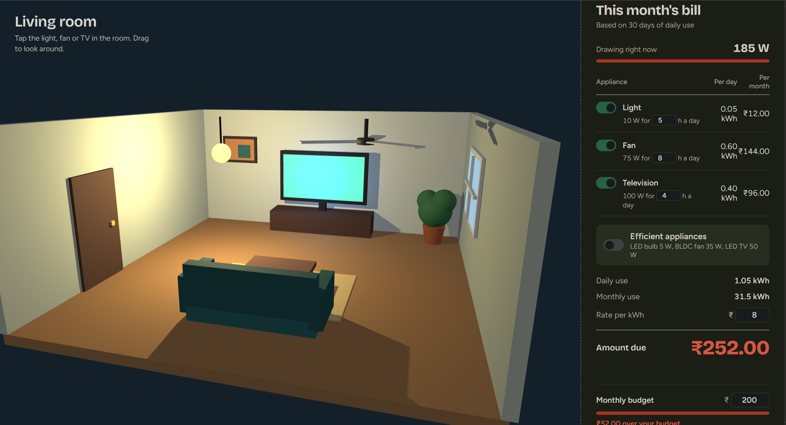

## 📸 Project Preview

The Electricity-Saving Home is an interactive 3D home simulation built with Three.js. Users can control appliances, monitor electricity consumption, estimate monthly bills, and explore energy-saving options.

### ✨ Features
- Interactive 3D living room.
- Toggle lights, fans, and televisions ON/OFF.
- Calculate daily and monthly electricity consumption.
- Estimate electricity bills in Indian Rupees (₹).
- Adjust appliance usage hours and electricity rates.
- Compare consumption against a monthly budget.
- Explore energy-efficient appliance alternatives.

### 🛠️ Tech Stack
- Three.js
- JavaScript
- HTML5
- CSS3
- Vite